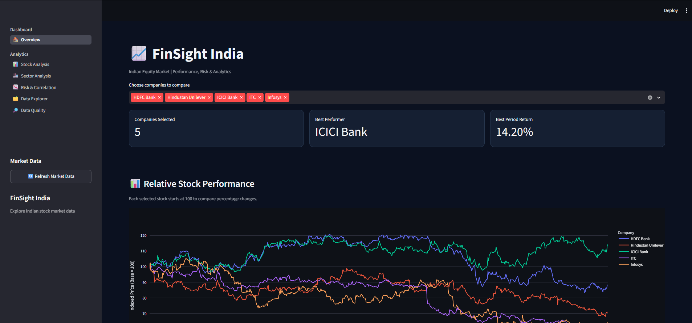
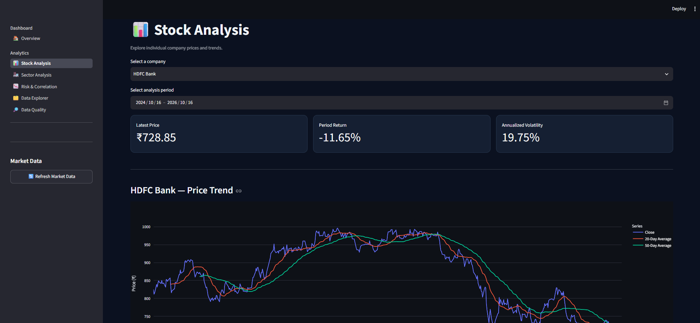
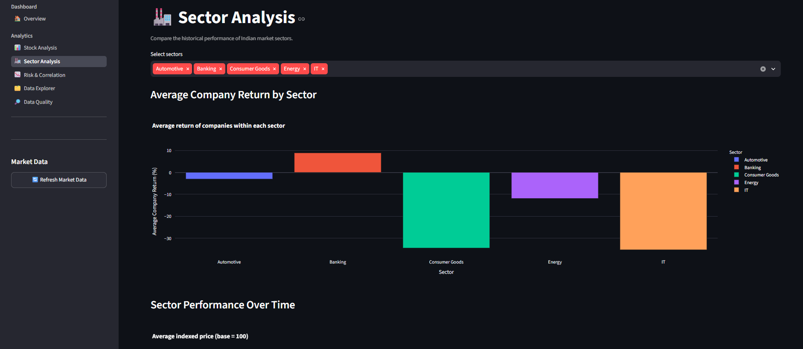
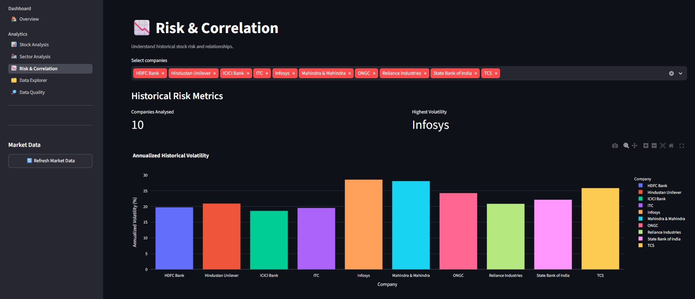
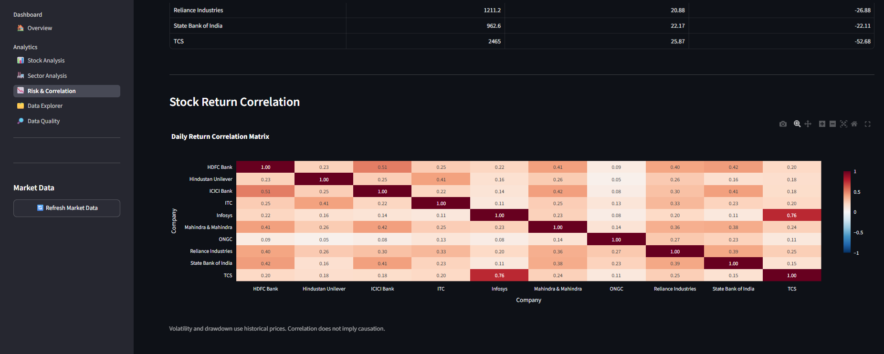
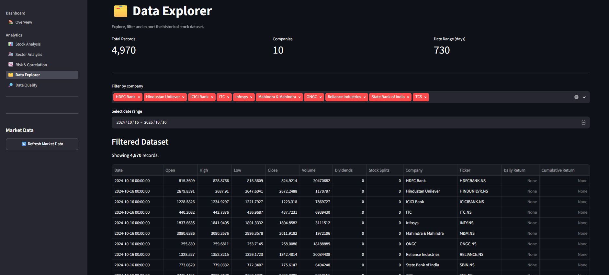
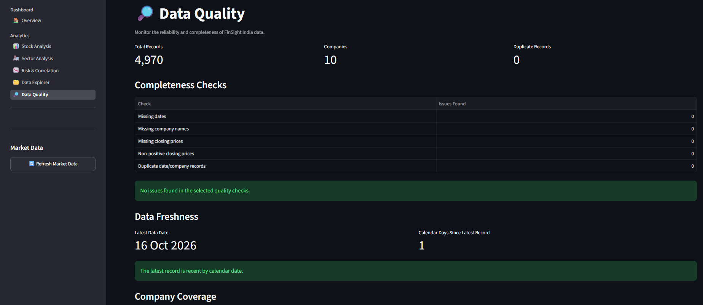
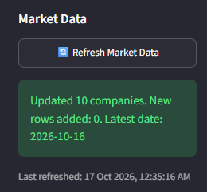

# 📈 FinSight India

**An interactive stock market analytics dashboard built with Python and Streamlit.**

FinSight India is a data analytics project that explores historical stock market data for selected companies listed on the National Stock Exchange of India (NSE). It transforms raw market data into interactive visualizations that help users understand stock performance, compare sectors, explore risk, and assess data quality.

The project demonstrates how Python-based data processing and visualization can make financial data easier to explore and interpret.

## ✨ Features

### 🏠 1. Overview Dashboard

Provides a high-level summary of the available market dataset and key information about the selected companies. It serves as the starting point for exploring the dashboard and navigating to the detailed analytical pages.



### 📊 2. Stock Analysis

Allows users to explore individual companies and examine historical stock price movements. Interactive charts help users identify trends and understand how a company's price has changed over the available period.



### 🏭 3. Sector Analysis

Groups selected companies into predefined sectors and compares their historical performance. Average returns and indexed-price visualizations make it easier to examine relative performance across the Banking, IT, Energy, Consumer Goods, and Automotive groups.



### 📉 4. Risk & Correlation

Examines historical stock-return behavior using annualized volatility, maximum drawdown, and daily return correlation. The correlation heatmap helps users explore whether the returns of different companies tend to move together or in opposite directions.




### 🗂️ 5. Data Explorer

Provides direct access to the underlying market dataset. Users can filter records by company and date, inspect the resulting data, review column information, and download filtered records as a CSV file for further analysis.



### 🔎 6. Data Quality

Checks selected aspects of the dataset, including missing values, duplicate date-company records, non-positive closing prices, company coverage, and the latest available data date. These checks help users identify potential data issues before interpreting analytical results.



### 🔄 7. Manual Market Data Refresh

Includes a sidebar button that attempts to retrieve recent historical market data through Yahoo Finance using `yfinance`. Successfully retrieved records are merged into the local dataset, duplicates are handled, and the application cache is cleared so updated data can be reloaded.




## 🏢 Companies Covered

The dataset contains ten selected NSE-listed companies across five project-defined sector groups.

| Sector | Companies |
|---|---|
| Banking | HDFC Bank, ICICI Bank, State Bank of India |
| IT | TCS, Infosys |
| Energy | Reliance Industries, ONGC |
| Consumer Goods | ITC, Hindustan Unilever |
| Automotive | Mahindra & Mahindra |

These groupings are intended for project-level comparison and may not represent official sector classifications.

## 🛠️ Technology Stack

The application is built with **Python** and **Streamlit**, with Pandas and NumPy supporting data processing and numerical analysis. Plotly provides interactive charts, while `yfinance` is used to retrieve historical market data. Git and GitHub are used for version control and source-code management.

## 📂 Project Structure

```text
FinSight-India/
├── app.py
├── market_data.csv
├── company_metrics.csv
├── requirements.txt
├── pages/
│   ├── 0_Overview.py
│   ├── 1_Stock_Analysis.py
│   ├── 2_Sector_Analysis.py
│   ├── 3_Risk_Correlation.py
│   ├── 4_Data_Explorer.py
│   └── 5_Data_Quality.py
├── src/
│   ├── analytics.py
│   ├── data_loader.py
│   └── refresh_data.py
└── screenshots/
```

The main `app.py` file configures the application and navigation. The `pages/` directory contains the dashboard's individual sections, while `src/` contains reusable data-loading, analytical, and refresh functions. The CSV files provide the market data used by the application.

## 🚀 Run Locally

To run FinSight India on your computer, first clone the repository and enter the project directory.

```bash
git clone https://github.com/ambfr/FinSight-India.git
cd FinSight-India
```

Create a virtual environment and activate it:

```bash
python -m venv .venv
```

On Windows PowerShell:

```powershell
.venv\Scripts\Activate.ps1
```

Install the required dependencies and launch the application:

```bash
pip install -r requirements.txt
python -m streamlit run app.py
```

Streamlit will display a local URL in the terminal, usually `http://localhost:8501`. Open that address in your browser to explore the dashboard.

## 📊 Data Source

The project uses historical stock market data retrieved through the `yfinance` Python library from Yahoo Finance. A local CSV dataset is included so the application can load its existing data without downloading the entire historical period at every launch.

Data availability, accuracy, and freshness are not guaranteed. The project uses historical observations for educational analysis rather than real-time trading.

## 🔮 Future Improvements

Potential improvements include expanding company coverage, adding automated tests for analytical calculations, improving data-refresh persistence in the hosted application, and introducing additional interactive visualizations.

## ⚠️ Disclaimer

FinSight India is an educational data analytics project. Historical performance does not guarantee future results, and the dashboard does not provide personalized investment advice.

## 🔗 Links

**GitHub Repository:** [FinSight India](https://github.com/ambfr/FinSight-India)

**Live Demo:** Coming soon!

